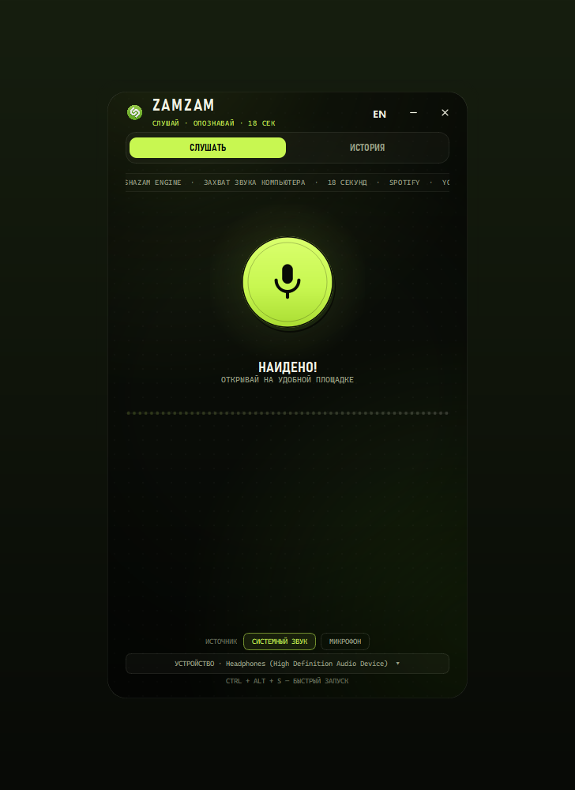
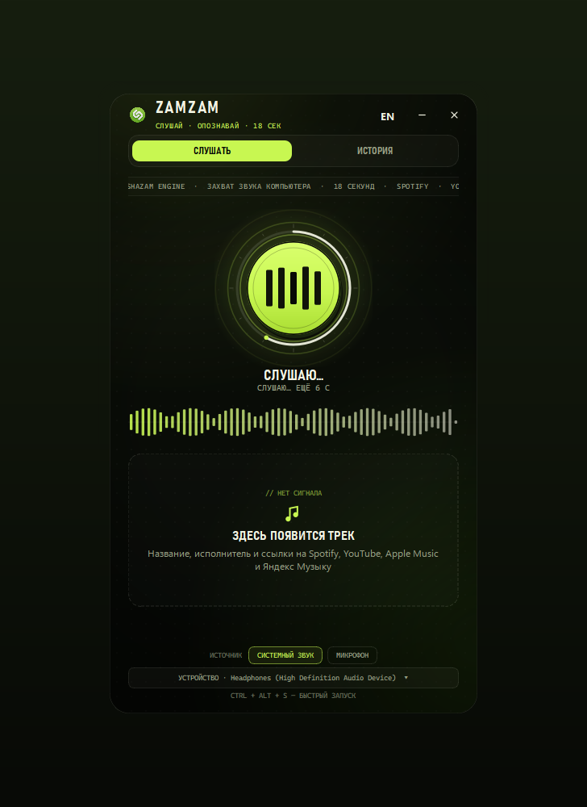
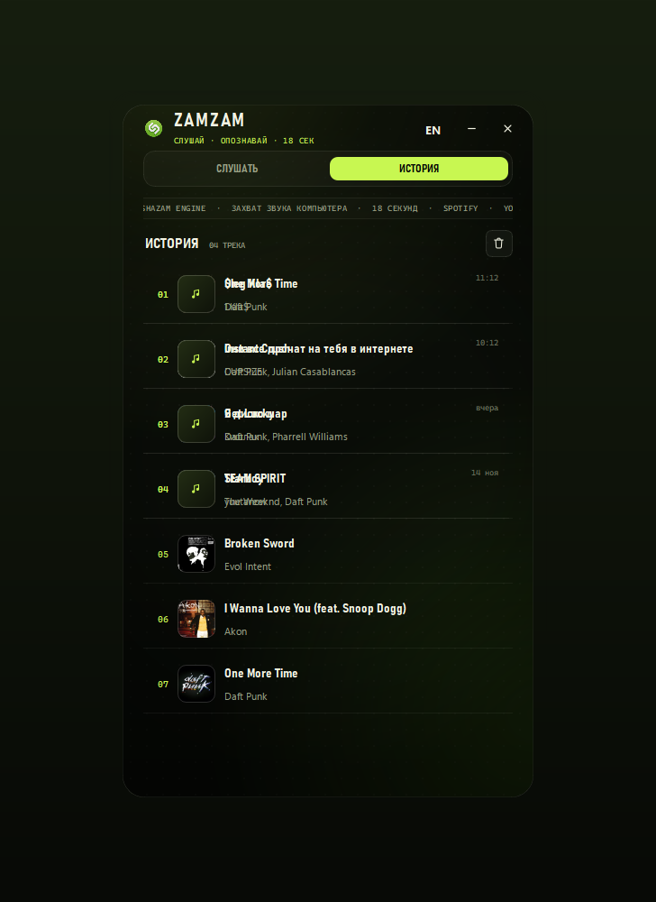

# Zamzam

**Zamzam** — приложение для Windows, которое слушает музыку, играющую на компьютере,
и определяет трек через Shazam: название, исполнителя, обложку, альбом, год и ссылки
на Spotify, YouTube, Apple Music и Яндекс Музыку.

Приложение не записывает микрофон постоянно и ничего не воспроизводит. Нажал кнопку —
оно послушало 18 секунд системного звука (YouTube, Spotify, браузер, плеер, игра) —
показало трек.

[](https://github.com/F16FFz/zamzam-music-recognition/releases/latest)
[](#системные-требования)
[](LICENSE.md)



## Скачать

Готовый `Zamzam.exe` лежит на странице **[Releases](https://github.com/F16FFz/zamzam-music-recognition/releases/latest)**.

1. Скачай `Zamzam.exe` из последнего релиза.
2. Запусти файл — установка не нужна.
3. При первом запуске Windows SmartScreen может показать предупреждение, потому что
   файл не подписан цифровым сертификатом. Нажми **«Подробнее» → «Выполнить в любом случае»**.
4. Нажми большую круглую кнопку и подожди около 18 секунд.

Ярлыки на рабочий стол и в меню «Пуск» можно создать командой:

```powershell
powershell -ExecutionPolicy Bypass -File install.ps1
```

## Возможности

- **Системный звук (WASAPI loopback)** — слышит YouTube, Spotify, браузер, плееры и игры,
  а не только микрофон.
- **Режим микрофона** — если музыка играет рядом: колонка, телефон, телевизор.
- **Выбор устройства** — можно указать конкретные колонки для системного звука или
  конкретный микрофон, если их несколько. Выбор сохраняется.
- **Надёжный микрофон** — если драйвер не поддерживается основным аудиодвижком,
  автоматически включается резервный захват, и микрофон всё равно работает.
- **Распознавание через Shazam** — без API-ключей и регистрации.
- Название, исполнитель, альбом, год, жанр и обложка.
- Ссылки на **Spotify, YouTube, Apple Music и Яндекс Музыку**. Если прямого трека нет,
  открывается поиск по названию.
- **История распознаваний** с обложками.
- **Работа в фоне и трей**: окно можно свернуть или закрыть в системный трей —
  приложение продолжает слушать по горячей клавише и показывает результат
  уведомлением.
- Глобальная горячая клавиша **Ctrl + Alt + S**.
- **Русский и английский интерфейс** — язык переключается на лету, без перезапуска.
- Тёмная тема, живые уровни звука и прогресс прослушивания.

### Трей и фон

Кнопки «свернуть» и «закрыть» прячут окно в системный трей, приложение при этом
не завершается. Значок в трее открывает меню: открыть окно, начать или остановить
прослушивание, перейти в историю, сменить язык и выйти. Если окно скрыто, результат
распознавания приходит уведомлением. Горячая клавиша **Ctrl + Alt + S** работает
и в фоне.

Windows 11 прячет значки новых приложений в переполнение — нажми **^** рядом
с часами, чтобы найти Zamzam, и перетащи значок на панель, если он нужен на виду.
Если системный трей почему-то недоступен, приложение не прячется: кнопка
«свернуть» работает как обычное сворачивание в панель задач. Выйти можно и без
трея — правый клик по шапке окна → **Выход**.

Если приложение уже запущено, повторный запуск `Zamzam.exe` просто показывает
уже открытое окно — второй экземпляр не создаётся.

| Прослушивание | История |
|---|---|
|  |  |

## Как это работает

1. `soundcard` открывает loopback-устройство системного микшера и пишет PCM 44.1 кГц.
2. Приложение слушает **18 секунд** и дважды отправляет накопленный звук в Shazam
   (на 15,5-й секунде — около 15 секунд, на 18,5-й — все 18). 15 секунд — проверенный
   минимум: на 10 секундах часть треков с длинным вступлением или сэмплом не находится.
3. `shazamio-core` (Rust) строит аудиоотпечаток, `shazamio` отправляет его на сервер Shazam.
4. Из ответа достаются метаданные и ссылки. Обложка кешируется, история хранится локально
   в `%LOCALAPPDATA%\Zamzam`.
5. Если нажать кнопку раньше таймера, приложение всё равно попробует распознать уже
   записанный фрагмент. Если запрос уже отправлен — дождётся ответа.

## Системные требования

- Windows 10 или Windows 11, 64-бит.
- Интернет: распознавание идёт на серверах Shazam.
- Около 150 МБ на диске (однофайловый exe распаковывается во временную папку).
- Не требуется Python, если используешь готовый `Zamzam.exe`.

## Сборка из исходников

Нужен Python 3.12 (подойдёт 3.10+).

```powershell
git clone https://github.com/F16FFz/zamzam-music-recognition.git
cd zamzam-music-recognition

python -m venv .venv
.\.venv\Scripts\python.exe -m pip install -r requirements.txt
.\.venv\Scripts\python.exe run.py
```

Сборка одного exe:

```powershell
powershell -ExecutionPolicy Bypass -File build.ps1
```

Результат: `dist\Zamzam.exe`. Скрипт сам создаёт окружение, ставит зависимости,
генерирует иконки и запускает PyInstaller.

Скриншоты для README:

```powershell
.\.venv\Scripts\python.exe tools\screenshot.py
```

## Тесты и диагностика

```powershell
.\.venv\Scripts\python.exe -m pip install -r requirements-dev.txt
.\.venv\Scripts\python.exe tools\test_recognition.py   # распознавание превью
.\.venv\Scripts\python.exe tools\test_flow.py          # полный цикл интерфейса
.\.venv\Scripts\python.exe tools\test_refine.py        # уточнение трека
.\.venv\Scripts\python.exe tools\test_manual_stop.py   # ручная остановка
.\.venv\Scripts\python.exe tools\test_morphy.py        # проблемный трек Morphy
.\.venv\Scripts\python.exe tools\test_devices.py       # список и выбор устройств
.\.venv\Scripts\python.exe tools\probe_windows.py      # какие длины фрагментов узнаются
.\.venv\Scripts\python.exe tools\audit.py              # геометрия интерфейса
```

Тесты используют временную папку и не трогают настоящую историю приложения.

## Если что-то не работает

Приложение ведёт локальный лог: `%LOCALAPPDATA%\Zamzam\zamzam.log` (и
`zamzam.log.1`). Там видно, запустилось ли приложение, появился ли значок в трее,
какое устройство выбрано и какие были ошибки. Лог никуда не отправляется сам —
его можно приложить к issue на GitHub.

## Ограничения

- Shazam — сторонний сервис, его неофициальный API может меняться.
- «Любая песня» — в пределах каталога Shazam. Если трека там нет (совсем новый,
  андеграунд, собственный релиз), распознавание не сработает.
- Лучше всего распознаётся припев или середина песни, а не тишина, разговор или
  самое начало с длинным вступлением.
- При очень тихом звуке включи громкость или режим микрофона.
- Это неофициальный клиент. Zamzam не связан с Apple, Shazam Entertainment Limited
  или их аффилированными лицами. «Shazam» — товарный знак соответствующего
  правообладателя.

## Приватность

- Приложение не собирает телеметрию и не отправляет данные разработчику.
- Записанный фрагмент отправляется на серверы Shazam для распознавания.
- История и настройки хранятся только на компьютере в `%LOCALAPPDATA%\Zamzam`.

## Лицензия

Проект распространяется по лицензии **Zamzam Free Use License**:
пользоваться можно бесплатно, но скачивать и распространять приложение разрешено
**только со страницы Releases официального репозитория**. Подробности — в
[LICENSE.md](LICENSE.md). Сторонние компоненты — в [THIRD_PARTY_NOTICES.md](THIRD_PARTY_NOTICES.md).

---

## English (short)

Zamzam is a Windows desktop app that listens to system audio and identifies the
song via Shazam. It shows title, artist, cover and links to Spotify, YouTube,
Apple Music and Yandex Music.

**Download:** see [Releases](https://github.com/F16FFz/zamzam-music-recognition/releases/latest).
No installation required. Windows SmartScreen may warn about an unsigned
executable — choose “More info → Run anyway”.

The app can be minimized or closed to the system tray and keep listening in the
background via **Ctrl + Alt + S**; the result appears as a tray notification.
You can pick a specific playback device for system audio or a specific
microphone. The interface is available in **Russian and English** and switches
instantly without a restart.

The app is free to use, but redistribution of builds is allowed **only** from the
official GitHub Releases page. See [LICENSE.md](LICENSE.md).
